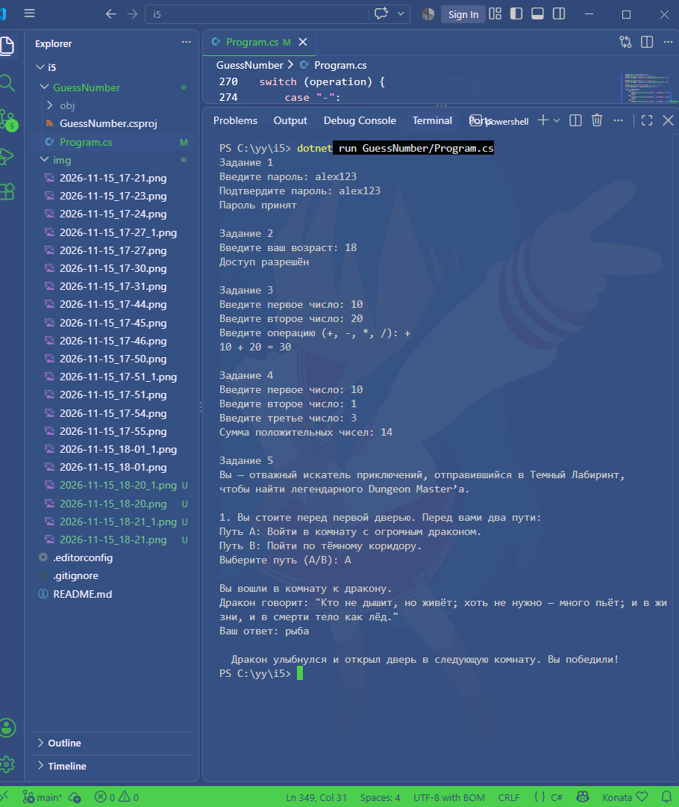
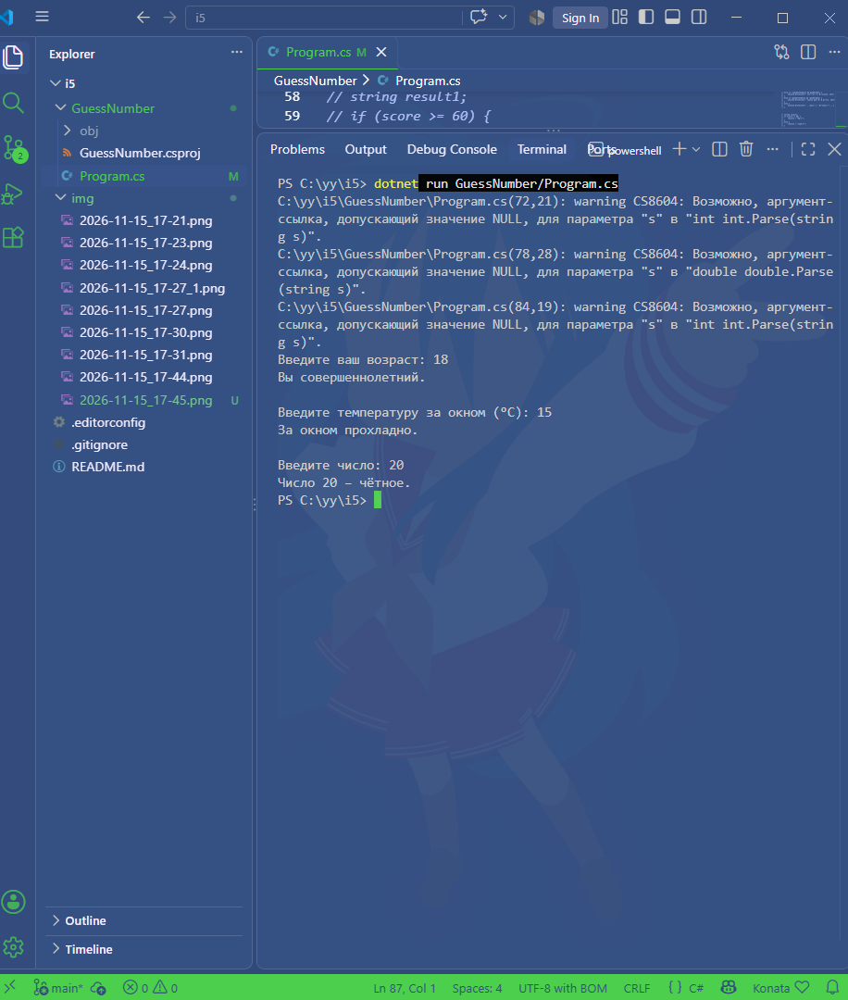

# Лабораторная работа №5

## Основная информация
* **ФИО:** Изингер Алексей
* **Группа:** ИСП-242


---

## Краткое описание работы
В рамках данной лабораторной работы были изучены и освоены базовые управляющие конструкции языка C#:
* Условные операторы `if/else` и вложенные условия для ветвления логики приложения.
* Логические операторы (`&&`, `||`, `!`) для построения сложных условий.
* Тернарный оператор как компактная альтернатива `if/else`.
* Оператор множественного выбора `switch/case` (включая группировку `case` и современный синтаксис паттерн-матчинга с условиями).
* Безопасное приведение типов с помощью метода `int.TryParse()`.

В качестве итогового проекта было разработано консольное приложение — игра «Угадай число».

---

## Структура проекта
```text
i5/
├── .editorconfig
├── .gitignore
├── README.md
├── img/
└── GuessNumber/
    ├── GuessNumber.csproj
    └── Program.cs
```

---

## Блок кода
Фрагмент реализации функции подсказки `GetHint()` с использованием современного синтаксиса `switch` (паттерн-матчинг):

```csharp
string GetHint(int difference) {
    switch (difference) {
        case <= 3:
            return "Горячо!";
        case <= 10:
            return "Тепло.";
        case <= 25:
            return "Прохладно.";
        default:
            return "Холодно!";
    }
}
```

---

## Итоговая таблица

| Конструкция | Когда использовать |
| :--- | :--- |
| `if/else` | Общее ветвление, сложные условия. |
| `else if` | Несколько взаимоисключающих вариантов. |
| `switch/case` | Сравнение одной переменной с конкретными значениями. |
| Тернарный оператор `? :` | Выбор одного из двух значений в одну строку. |
| `&&` | Логическое И — оба условия должны быть истинны. |
| `||` | Логическое ИЛИ — хотя бы одно условие должно быть истинно. |
| `!` | Логическое НЕ — отрицание/инверсия условия. |
| `int.TryParse()` | Безопасное преобразование строки в число без вызова исключений. |
| `Random.Next(min, max)` | Генерация случайного целого числа в заданном диапазоне. |

---

## Ответы на вопросы

1. **Чем `int.TryParse()` безопаснее `int.Parse()`? В каких случаях стоит использовать каждый?**
   * `int.Parse()` выбрасывает исключение (`FormatException`), если строка содержит некорректные символы (например, буквы), что приводит к аварийной остановке программы.
   * `int.TryParse()` не вызывает исключений. Он возвращает `false`, если преобразование невозможно, и `true` в случае успеха, записывая результат в `out`-переменную.
   * *Когда использовать:* `int.TryParse()` идеален для обработки пользовательского ввода в консоли. `int.Parse()` применим, когда корректность данных гарантирована внешними условиями или когда падение программы при неверных данных является ожидаемым поведением.

2. **Когда `switch` удобнее, чем цепочка `if/else if`? Приведите пример из реальной жизни.**
   * `switch` удобнее, когда одна переменная сравнивается с большим количеством конкретных, дискретных значений. Он делает код более наглядным и структурированным.
   * *Пример из жизни:* Обработка выбора пункта в интерактивном меню (нажатие цифр 1–4) или определение названия дня недели по его порядковому номеру.

3. **Что произойдёт в `switch`, если убрать `break` после одного из `case`?**
   * В C# компилятор выдаст ошибку сборки (*Control cannot fall through from one case label to another*), так как сквозное выполнение (fall-through) между непустыми блоками `case` запрещено. Убрать `break` разрешается только в том случае, если блок `case` полностью пуст — тогда это используется для группировки условий.

4. **Чем отличается `=` от `==` в C#? Почему это частая ошибка?**
   * `=` — это оператор присваивания (записывает значение правого выражения в левую переменную).
   * `==` — это оператор сравнения (проверяет равенство двух значений и возвращает логический тип `true` или `false`).
   * Это частая ошибка среди новичков, так как в обычной математике один знак равенства используется как для обозначения равенства, так и для уравнений, из-за чего возникает путаница при написании условий в коде.

5. **Можно ли написать тернарный оператор внутри другого тернарного оператора? Приведите пример из кода лабораторной и оцените читаемость такого кода.**
   * Да, такая вложенность возможна. Пример из текста лабораторной работы:
     ```csharp
     string weather = temp >= 20 ? "тепло" : (temp >= 0 ? "прохладно" : "мороз");
     ```
   * *Оценка читаемости:* Читаемость такого кода значительно падает. Если условий становится больше двух, вложенные тернарные операторы превращают строку в громоздкую конструкцию, которую тяжело отлаживать. В таких ситуациях лучше использовать классический `if/else`.

---

## Главные выводы
1. Использование безопасных методов валидации данных (таких как `int.TryParse`) критически важно для предотвращения аварийных сбоев приложения при некорректном вводе пользователя.
2. Выбор между `if/else` и `switch/case` должен основываться на читаемости кода: для диапазонов и сложных логических связок подходит `if`, а для явного перебора фиксированных значений — `switch`.
3. Эффективная структура репозитория Git и фиксация каждого этапа работы с помощью коммитов позволяют поддерживать прозрачную историю разработки и упрощают совместную работу.


## Скриншоты 



